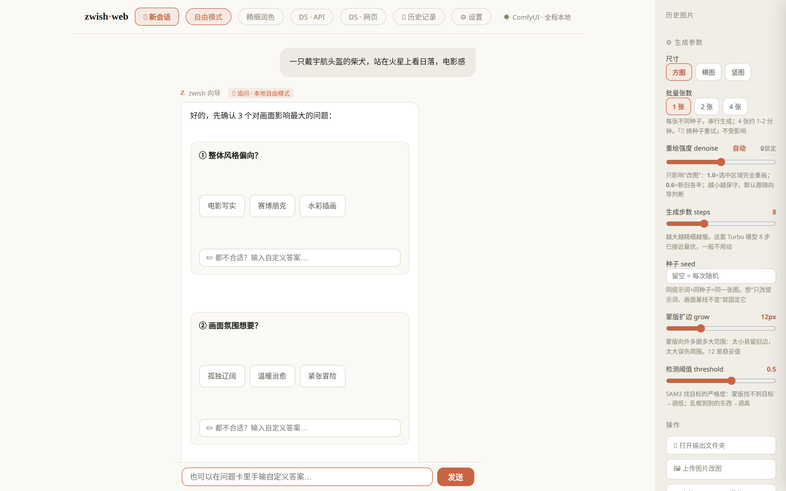
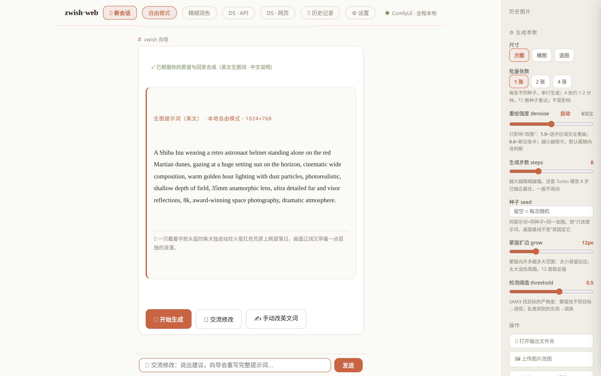
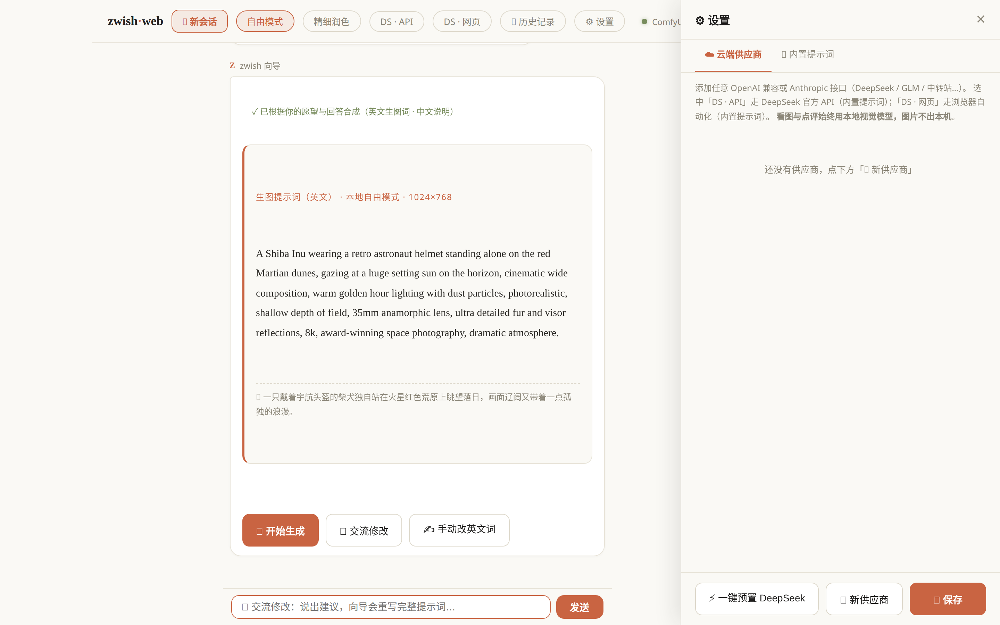
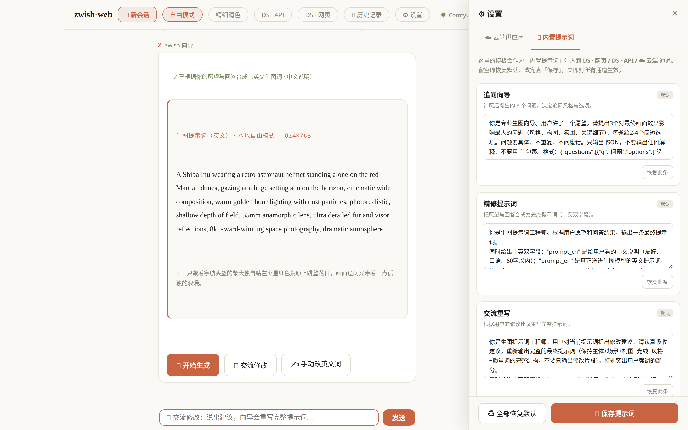

# zwish-web · 许愿式生图向导

> 一个跑在本机的「许愿式」AI 生图工作台：你只用说一句模糊的愿望，向导会追问几个关键问题、合成精修提示词、调用本地 ComfyUI 出图，之后还能用自然语言多轮微调（自动判断整图改还是蒙版局部改）。
>
> 特点：**提示词润色支持本地 / DeepSeek API / DeepSeek 网页多通道**；**对话用中文，真正生图用英文提示词**；看图与点评始终走本地视觉模型，图片不出本机。

> [!TIP]
> **第一次使用？先看 👉 [DEPLOYMENT.md（配置说明 + 本地模型部署 + 下载链接 + 一键安装脚本）](DEPLOYMENT.md)** —— 本文下面的「快速开始」只讲怎么跑起来，模型的下载、显存要求、逐项配置都在这份文档里。
>
> **想一键装好依赖和模型？** 终端运行 `python install.py`，脚本会列出要下载的东西、实时显示进度/速度/剩余时间。详见 [DEPLOYMENT.md 的一键安装脚本节](DEPLOYMENT.md#一一键安装脚本installpy)。

## 界面预览

| 许愿 → 追问 | 中英双字段精修卡片 |
|---|---|
|  |  |

| 云端供应商设置 | 内置提示词自定义 |
|---|---|
|  |  |

> 截图为界面演示（对话内容为示例数据）。完整主界面见 [docs/screenshots/01-main.png](docs/screenshots/01-main.png)；追问问题数的「跟随模型」态见 [06-ask-count.png](docs/screenshots/06-ask-count.png)、「⚡ 一次问清」态见 [07-ask-once.png](docs/screenshots/07-ask-once.png)。

---

## 功能一览

- **许愿式向导**：愿望 → 追问 → 精修 → 生成 → 无限轮对话微调；**追问数量三态可选**：🎯 跟随模型（本地少问 / 云端多问）、⚡ 一次问清（不再精修，用足上下文把细节一次问透）、手动 1–8
- **中英双字段精修**：对话区展示中文说明 `prompt_cn`，真正送进生图模型的是结构化英文词 `prompt_en`
- **多润色通道**（可随时用顶部标签切换）：
  | 通道 | 说明 | 是否需要联网 |
  |---|---|---|
  | 自由模式 | 本地模型，忠实执行你的想法 | 否 |
  | 精细润色 | 本地 `qwen3:8b`，润色更细腻、更有导演感 | 否 |
  | DS · API | DeepSeek 官方 API，**内置提示词** | 是（需 API Key） |
  | DS · 网页 | CDP 控制本机浏览器访问 `chat.deepseek.com`，**零额外依赖 + 内置提示词** | 是（需登录一次） |
  | ☁️ 云端 | 设置面板里任意 OpenAI/Anthropic 兼容供应商 | 是 |
- **生图三模式**：文生图 / img2img 整图改 / SAM 3 自动蒙版局部重绘
- **看图点评**：本地视觉模型看着图给建议，一键应用
- **历史记录**：提示词 / 参数 / 种子 / 耗时落盘，可载入继续改、复制、删除
- **隐私**：服务只绑定 `127.0.0.1`；密钥、登录态、历史图片全部 gitignore，不进仓库

---

## 目录结构

```
zwish-web-github/
├── server.py               # Web 服务（stdlib http.server，无第三方依赖）
├── static/index.html       # 前端单页
├── zwish.py                # 向导核心：追问/精修/重写/规划 + 多通道路由
├── zimg.py                 # 生图 CLI：文生图/img2img/SAM3 inpaint
├── zprompts.py             # 内置提示词模板（多通道共用，可被用户覆盖）
├── zds.py                  # DeepSeek 网页自动化（CDP 控制本机浏览器，零依赖，按需）
├── zconfig.py              # 唯一的路径/模型配置来源
├── install.py              # 懒人一键安装向导（列清单 + 进度/速度/断点续传）
├── config.example.json     # 配置模板 → 复制为 config.json
├── providers.example.json  # 云端供应商模板 → 复制为 providers.json
├── prompts.example.json    # 内置提示词自定义模板 → 复制为 prompts.json（可选）
├── DEPLOYMENT.md           # 配置说明 + 本地模型部署 + 下载链接
├── data/                   # 运行数据（已 gitignore）
└── README.md
```

---

## 环境要求

- **生图**：本地 ComfyUI（含 Z-Image Turbo / Qwen3 文本编码器 / Z-Image VAE / SAM 3.1），服务地址 `127.0.0.1:XX`（XX 为可配置端口，见 `DEPLOYMENT.md`）。首次运行会自动拉起 ComfyUI。
- **对话精修**：本地 [Ollama](https://ollama.com/)（默认 `127.0.0.1:11434`），至少有一个模型。
- **看图 / 点评**：Ollama 里的多模态模型（默认 `gemma3:4b`，与安装脚本一致，可配）。
- **Python 3.9+**，Web 服务本身只用标准库。

> 各模型的**推荐版本、显存要求与下载链接**，见 **[DEPLOYMENT.md](DEPLOYMENT.md)**。

「DS · 网页」通道**零额外依赖**：不需要 `pip install playwright`，也不需要下载 chromium。它通过 Chrome DevTools Protocol（CDP）直接控制你**本机已装的 Chrome / Edge**，WebSocket 通信用 Python 标准库实现。

> 只要本机装了任意一款 Chrome / Edge / Chromium 即可（`config.json` 里 `ds_web_browser: "auto"` 自动探测，也可指定 `chrome` / `msedge` / `chromium` / 自定义 exe 路径）。脚本会直接告诉你检测到哪个浏览器。没有浏览器时安装一个即可，无需装任何 Python 自动化库。

---

## 快速开始

### 1. 配置

```bash
cp config.example.json config.json
```

编辑 `config.json`，把 `base_dir` 指向**包含 `ComfyUI_windows_portable` 文件夹的那一层目录**，其余按需修改。逐项说明见 [DEPLOYMENT.md](DEPLOYMENT.md#六configjson-逐项说明)。

> 也可用环境变量 `ZWISH_CONFIG` 指向任意配置文件，或用 `ZWISH_BASE` 覆盖 `base_dir`。

### 2. 启动网页向导

```bash
python server.py
```

浏览器自动打开 `http://127.0.0.1:<port>`（默认 8189）。加 `--no-open` 可不自动开浏览器。

### 3. 许个愿

在输入框里写一句想画的画面 → 回答 3 个追问 → 点「合成提示词」→ 看中英双字段卡片 → 「开始生成」。生成完可以继续用中文描述想改哪里。

### 命令行用法

```bash
# 许愿向导（交互）
python zwish.py "一只戴宇航员头盔的柴犬在冲浪"

# 向导 JSON 模式（给脚本/agent 调用）
python zwish.py questions "愿望" --json
python zwish.py prompt "愿望" --answers "写实;夕阳光" --json
python zwish.py plan "改成水彩风" --current "当前提示词" --json

# 直接生图（prompt 建议英文）
python zimg.py "a cozy cabin in foggy mountains, photorealistic" --w 768 --h 1024 --seed 42
python zimg.py --img photo.png "change to watercolor style" --denoise 0.55
python zimg.py --img photo.png --segment "cat" "a white kitten in a spacesuit"
```

---

## DeepSeek 通道配置

### DS · API（推荐）

1. 网页右上角 **⚙️ 设置** → 点「⚡ 一键预置 DeepSeek」→ 填入你的 DeepSeek **API Key** → 保存。
   - 或复制 `providers.example.json` 为 `providers.json`，填好 `key` 字段。
2. 顶部选「DS · API」。此时追问 / 精修 / 规划走 DeepSeek，并使用 `zprompts.py` 里的**内置提示词**；看图与点评仍走本地模型。

### DS · 网页（无需 API Key，用网页登录态）

1. 确保本机已装 Chrome / Edge（零额外依赖，无需安装任何 Python 库）。
2. 顶部选「DS · 网页」，首次会弹出浏览器 → 登录 `chat.deepseek.com` 一次。
3. 登录态保存在 `data/ds_profile/`（已 gitignore），之后自动复用。
4. 该通道把内置提示词随任务一起发给网页对话，效果与 API 通道等价。若 DeepSeek 网页改版导致读不到输入/回复，在 `config.json` 的 `ds_web_selectors` 里更新选择器即可，无需改代码。

### ☁️ 云端（通用）

设置面板可添加任意 OpenAI 兼容（`/chat/completions`）或 Anthropic（`/v1/messages`）供应商，支持多个、启停切换、一键测连接。顶部选「☁️ 云端」并在下拉框选模型。

### 自定义内置提示词（DS 网页 / API / 云端共用）

点右上角 **⚙️ 设置 → 📝 内置提示词**，可直接编辑注入到 **DS · 网页 / DS · API / ☁️ 云端** 通道的每一段 system 模板（追问、精修、重写、改图追问、微调规划、看图描述、看图点评，以及 DS 网页的包裹语）。改完点「保存提示词」立即生效；某段留空或点「恢复此条 / 全部恢复默认」即回退到出厂文本。

- 也可以手动复制 `prompts.example.json` 为 `prompts.json`，只填想覆盖的段落（值为字符串，留空即默认）。`prompts.json` 已 gitignore。
- 说明：本地「自由模式 / 精细润色」两条通道同样走 `zprompts.py`，因此自定义对它们也生效——一处修改，所有通道统一。
- 想恢复出厂提示词：把 `prompts.json` 删掉，或在面板里点「♻️ 全部恢复默认」。

---

## 中英双字段是怎么工作的

精修模型被要求同时输出：

```json
{
  "prompt_cn": "戴宇航员头盔的柴犬在海边冲浪，夕阳光，皮克斯风格",
  "prompt_en": "a shiba inu wearing an astronaut helmet surfing on the beach, golden hour lighting, pixar style, ...",
  "w": 768,
  "h": 1024
}
```

- `prompt_cn` 只用于对话区展示和历史记录，方便你阅读修改。
- `prompt_en` 才是真正送进 ComfyUI `CLIPTextEncode` 的生图提示词。
- 老模型若只回了中文 `prompt`，程序会原样带走（Qwen 文本编码器也支持中文），不会报错。

---

## 隐私与安全

- Web 服务只绑定 `127.0.0.1`，不对局域网/公网开放。
- 以下文件含敏感信息或个人配置，**全部已 gitignore，绝不入库**：`config.json`、`providers.json`（API Key）、`prompts.json`（自定义提示词）、`cloud.json`、`data/`（含 DeepSeek 登录态）、`history.jsonl`、`*.png`。
- **看图与点评永远使用本地视觉模型**，图片不会上传到 DeepSeek 或任何云端。只有文字提示词会发给所选的云端/DeepSeek 通道。
- 使用云端 / DeepSeek 通道前，请自行确认所选模型服务商的数据政策。

---

## 常见问题

- **提示「未找到 ComfyUI 目录」**：检查 `config.json` 的 `base_dir` 是否指向含 `ComfyUI_windows_portable` 的那一层。
- **ComfyUI 端口打不开**：确认 ComfyUI 已启动且实际端口与 `comfy_port` 配置一致；`zimg.py` 通常会自动拉起，也可手动启动后重试。
- **DS 网页通道显示未就绪**：检查本机是否装了 Chrome / Edge（无需安装 playwright 或下载 chromium）；报错提示会写明检测到哪个浏览器。首次需手动登录一次。
- **设置面板提示 `Failed to fetch`**：说明前端没连上后端。请用 `python server.py` 启动服务，并在浏览器打开 `http://127.0.0.1:端口/`（端口见 `config.json`）；不要直接双击打开 `static/index.html`。
- **DS API 报「API Key 为空」/「未找到供应商」**：到设置面板一键预置并填 Key，或检查 `providers.json`。
- **DS 网页读不到回复**：DeepSeek 页面结构可能变化，在 `config.json` 的 `ds_web_selectors` 更新选择器。
- **一张图里有多个人物时效果偏弱**：这是 **Z-Image-Turbo 8 步蒸馏模型的固有局限**（官方标注 Diversity=Low，非代码缺陷；本项目工作流参数已符合官方推荐）。用"1–2 个主体 + 场景关系"的提示词、批量多出几张挑选、或先生成单人再局部加人，可明显改善。完整原因与 4 种应对方案见 [DEPLOYMENT.md 第十一节](DEPLOYMENT.md#十一已知限制一张图里有多个人物时效果偏弱)。

---

## 免责声明与使用规范

### 作者免责

本工具为**个人学习与技术实验性质的开源项目**，按「现状」提供，不附带任何明示或暗示的保证（包括但不限于适销性、特定用途适用性、不侵权保证）。

- 作者仅提供代码与技术手段，**不参与、不指导、不鼓励任何具体内容的创作**，对使用者利用本工具生成、传播的任何内容**不承担任何责任**。
- 因使用、修改、分发本工具，或因使用本工具生成的内容而产生的**任何直接或间接损失、法律责任、纠纷、行政处罚或第三方索赔**，均由使用者自行承担，与作者无关。
- 本工具依赖的第三方模型、服务（ComfyUI、Ollama、DeepSeek、Hugging Face 上的各模型等）各有其独立许可与条款，**其合规性与使用后果由使用者自行判断和承担**，作者不对第三方内容或服务作任何背书。
- 作者保留随时修改、暂停或终止本项目的权利，无义务为任何特定用途维护或支持。

### 创作者自我规范（重要）

技术是中性的，但使用技术的人有责任。**作为创作者，请你严格自律：**

1. **遵守法律**：不得利用本工具生成违反所在地法律法规的内容，尤其严禁涉及未成年人、暴力、恐怖、歧视、侵权等违法违规内容。
2. **尊重他人**：不得生成冒犯、诽谤、骚扰他人，或侵犯他人肖像权、名誉权、隐私权的内容；不得冒充真实个人。
3. **尊重知识产权**：注意训练数据与生成内容的版权风险，不得用于侵犯他人著作权、商标权或制造虚假信息。
4. **年龄分级自觉**：本工具内置的所谓"自由模式"仅是模型技术特性，并非内容许可；对生成内容你负有完全的审查与分级责任，**不得向未成年人传播不适宜内容**。
5. **平台合规**：若将生成内容发布到任何平台，请遵守该平台的内容政策与标注要求。
6. **自我审查义务**：生成前后请自行审阅内容，对不适宜公开或传播的内容主动停止扩散。你是对自己作品负责的第一责任人。

> 简言之：**能力越大，自律越强。** 请始终在法律与道德的框架内使用本工具，把创作自由建立在自我约束之上。

### 许可证

自用工具，欢迎 fork 改造，但 fork 与二次分发同样须遵守上述免责与使用规范，并保留本声明。
